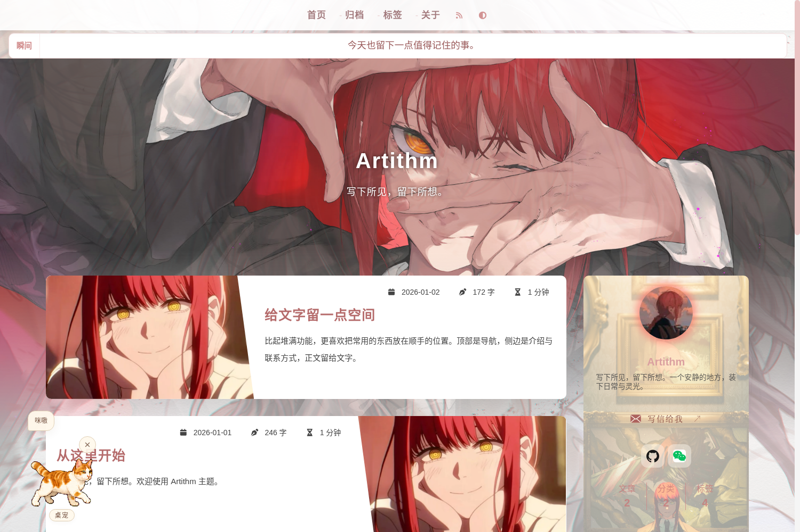
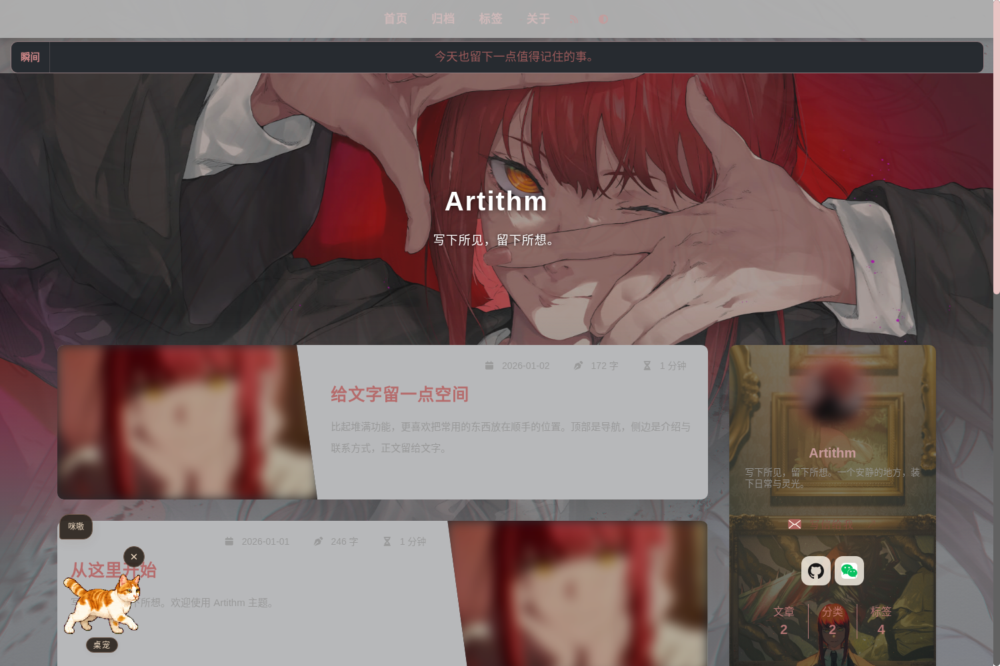
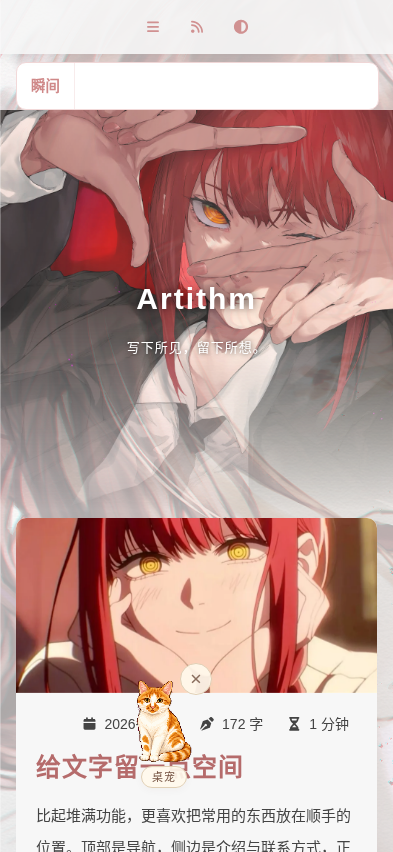

# Artithm

[简体中文](README.md) · English

Artithm is a Hugo theme put together from my personal blog. I think my taste (my waifu, Makima) is pretty decent, so I decided to share it.

The code is based on [Reimu](https://github.com/D-Sketon/hugo-theme-reimu), with some inspiration and layout ideas from [Hao](https://github.com/chengzhongxue/halo-theme-hao).

[My blog](https://artithm.com/) · [Example configuration](exampleSite/hugo.toml) · [Contact guide](docs/contact-links.en.md) · [Asset notices](NOTICE.en.md)



<details>
<summary>Dark mode and mobile previews</summary>





</details>

## Features

- Light and dark modes, responsive layouts, archives, categories, tags, a table of contents, and syntax highlighting.
- A soft rose palette, title focus effects, and an opening-door loading animation. Page and sidebar backgrounds can be set separately.
- A homepage Moments ticker and a separate Moments page, both using a YAML file for short updates.
- Local SVG contact icons, with profile links, account details, QR codes, and a copy button.
- An animated desktop pet you can click, drag, rename, hide, or turn off.
- An optional letter dialog. By default, the email button opens the visitor's mail app; the dialog needs your own backend.

## Try it out

Requires **Hugo Extended 0.158.0 or later**. Tested with **0.162.1**. No npm or Node.js is needed.

```bash
git clone https://github.com/emirage-niallchen/hugo-theme-artithm.git
cd hugo-theme-artithm
hugo server --source exampleSite --themesDir ../..
```

Open the local URL shown in your terminal. The demo uses Chinese sample posts and placeholder contact details; replace them with your own.

To build the demo:

```bash
hugo --source exampleSite --themesDir ../.. --destination ../public --gc --minify
```

## Install on your blog

Run this in your Hugo site directory. The site must already be a Git repository to use a submodule:

```bash
git submodule add https://github.com/emirage-niallchen/hugo-theme-artithm.git themes/hugo-theme-artithm
```

Select the theme in your site configuration. For an English site:

```toml
theme = 'hugo-theme-artithm'
defaultContentLanguage = 'en'

[languages.en]
locale = 'en'
label = 'English'

[params]
author = 'Your name'
description = 'Your introduction'
mainSections = ['posts']
```

Put posts in `content/posts/`. If you use `post/` or another directory, change `mainSections` to match. You can copy the archive and Moments page files from [the example site](exampleSite/content). See [exampleSite/hugo.toml](exampleSite/hugo.toml) for a full starting configuration and [config/_default/params.yml](config/_default/params.yml) for all defaults.

## Common settings

Merge the following settings into your `hugo.toml`. Add entries to existing tables rather than declaring the same table twice.

### Backgrounds and avatar

Put images in your site's `static/images/` directory, then use a site path or a full URL in the configuration. Leave background values empty to use the theme's base colors.

```toml
[params]
avatar = '/images/avatar.png'
banner = '/images/banner.webp'

[params.artithm]
background = '/images/background.webp'
sidebar_background = '/images/sidebar.webp'
click_effect = true
```

### Contact links

A URL opens directly. Account details or a QR code open a contact card. Empty entries are hidden.

```toml
[params.contact]
email = 'hello@example.org'
github = 'https://github.com/yourname'
wechat = { account = 'Your account', qrcode = '/images/wechat.png', note = 'Scan to follow' }
```

Platform names and their order are defined in `data/contact.yml`. Override it with a file at the same path in your site. See the [contact guide](docs/contact-links.en.md) for more options.

### Moments

Create `data/moments.yml`:

```yaml
items:
  - text: Something worth remembering today.
    date: '2026-01-01'
```

Then create `content/moments.md`:

```yaml
---
title: Moments
layout: moments
---
```

The homepage ticker is hidden when there are no entries. Set `epigraph` under `[params.moments]` to change the page's opening line.

### Desktop pet

```toml
[params.pet]
enable = true
name = 'Desktop pet'
nicknames = ['Desktop pet', 'On a break', 'On duty']
```

Set `enable = false` to turn it off. See the [pet guide](docs/pet.en.md) to replace the sprite sheet.

### Letter dialog

By default, `params.letter.enable = false` and the email button uses `mailto:`. Only enable the dialog after connecting a compatible backend:

```toml
[params.letter]
enable = true
endpoint = '/api/letter'
challenge_endpoint = '/api/letter-challenge'
image = 'images/mkm-letter.png'
```

See the [letter dialog guide](docs/letterbox.en.md) for the API contract. This repository provides the interface, without a mail server or Cloudflare Functions. Keep SMTP passwords and other credentials out of Hugo configuration and static files.

## Directory layout

| Path | Contents |
| --- | --- |
| `layouts/` | Page templates, contact cards, and the desktop pet |
| `assets/` | Styles, scripts, and the pet sprite sheet |
| `static/` | Images, fonts, and icons |
| `config/_default/params.yml` | Default theme settings |
| `exampleSite/` | A demo site you can build locally |
| `docs/` | Configuration and extension guides in Chinese and English |

After updating the theme, run `hugo --gc --minify` in your site to check the build. Keep your template and style overrides in the matching directories of your own site.

## Credits and license

Thanks to [Reimu](https://github.com/D-Sketon/hugo-theme-reimu) for the code base and [Hao](https://github.com/chengzhongxue/halo-theme-hao) for inspiration and layout ideas.

The code is licensed under [MIT](LICENSE). See the [asset notices](NOTICE.en.md) for other materials.
