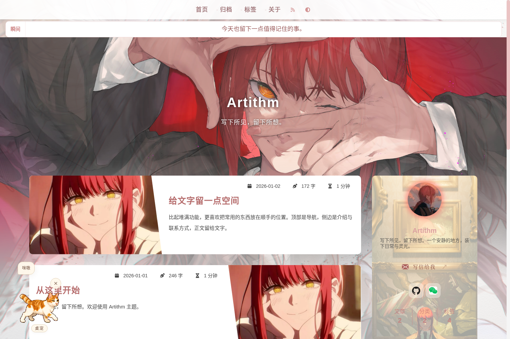
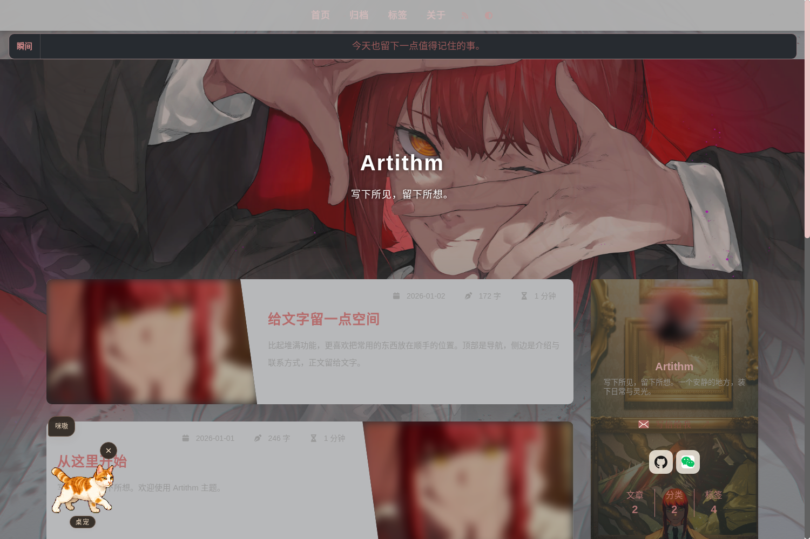
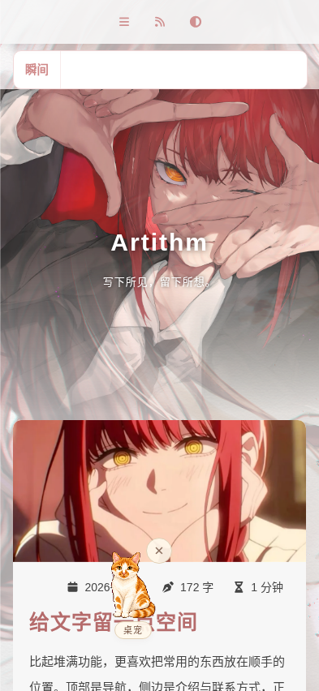

# Artithm

简体中文 · [English](README.en.md)

Artithm 是从我的个人博客里整理出来的 Hugo 主题。因为认为自己的品味（电子老婆-玛奇玛）还可以，所以把这个主题挂了出来。

源代码基于 [Reimu](https://github.com/D-Sketon/hugo-theme-reimu)，部分灵感与布局样式参考了 [Hao](https://github.com/chengzhongxue/halo-theme-hao)。

[我的博客](https://artithm.com/) · [示例配置](exampleSite/hugo.toml) · [联系方式配置](docs/contact-links.md) · [版权](NOTICE.md)



<details>
<summary>深色模式与手机预览</summary>





</details>

## 有些什么

- 浅色、深色模式与响应式布局，支持归档、分类、标签、目录和代码高亮。
- 淡玫瑰配色、标题聚焦与开门式加载动画，背景图和侧栏背景可单独配置。
- 首页「瞬间」轮播和独立瞬间页面，用一份 YAML 记录日常。
- 本地 SVG 联系方式图标，支持主页链接、账号、二维码和复制账号。
- 桌宠：点击、拖动、换称号、收起；可以关闭。
- 可选的写信弹窗。默认邮件按钮打开邮件客户端；开启弹窗需要自己接入后端。

## 先跑起来

需要 **Hugo Extended 0.158.0 或更高版本**，本项目使用 **0.162.1** 验证。纯静态主题无需 npm 或 Node。

```bash
git clone https://github.com/emirage-niallchen/hugo-theme-artithm.git
cd hugo-theme-artithm
hugo server --source exampleSite --themesDir ../..
```

打开终端提示的本地地址。示例文章和联系方式都是演示数据，可直接替换。

构建示例站点：

```bash
hugo --source exampleSite --themesDir ../.. --destination ../public --gc --minify
```

## 安装到自己的博客

在已有 Hugo 站点目录执行；使用 Git 子模块前，站点需要先是一个 Git 仓库：

```bash
git submodule add https://github.com/emirage-niallchen/hugo-theme-artithm.git themes/hugo-theme-artithm
```

在站点配置中选择主题：

```toml
theme = 'hugo-theme-artithm'
defaultContentLanguage = 'zh-cn'
hasCJKLanguage = true

[languages.zh-cn]
locale = 'zh-CN'
label = '简体中文'

[params]
author = '你的名字'
description = '你的介绍'
mainSections = ['posts']
```

文章放在 `content/posts/`。如果原站文章放在 `post/` 或其他目录，同步修改 `mainSections`。归档页和瞬间页可以复制 [示例站点的对应文件](exampleSite/content)。完整起点见 [exampleSite/hugo.toml](exampleSite/hugo.toml)，全部默认参数在 [config/_default/params.yml](config/_default/params.yml)。

## 常用配置

下面各段合并到自己的 `hugo.toml`，相同的表不要重复声明。

### 背景与头像

图片放在站点的 `static/images/` 下，配置中写站内路径或完整网址。留空背景时使用主题的基础配色。

```toml
[params]
avatar = '/images/avatar.png'
banner = '/images/banner.webp'

[params.artithm]
background = '/images/background.webp'
sidebar_background = '/images/sidebar.webp'
click_effect = true
```

### 联系方式

网址直接显示链接；账号或二维码显示为弹窗。留空的项自动隐藏。

```toml
[params.contact]
email = 'hello@example.org'
github = 'https://github.com/yourname'
wechat = { account = '你的账号', qrcode = '/images/wechat.png', note = '扫码关注' }
```

平台顺序与名称在 `data/contact.yml` 中定义，也可以在站点里放一份同名文件覆盖。详见 [联系方式配置](docs/contact-links.md)。

### 瞬间

创建 `data/moments.yml`：

```yaml
items:
  - text: 今天也留下一点值得记住的事。
    date: '2026-01-01'
```

再创建 `content/moments.md`：

```yaml
---
title: 瞬间
layout: moments
---
```

没有数据时，首页瞬间条自动隐藏。页面题记可通过 `[params.moments]` 的 `epigraph` 修改。

### 桌宠

```toml
[params.pet]
enable = true
name = '桌宠'
nicknames = ['桌宠', '摸鱼中', '营业中']
```

设为 `enable = false` 后关闭桌宠。更换素材见 [桌宠配置](docs/pet.md)。

### 写信弹窗

默认 `params.letter.enable = false`，邮件按钮使用 `mailto:`。只有接好兼容的后端后再开启：

```toml
[params.letter]
enable = true
endpoint = '/api/letter'
challenge_endpoint = '/api/letter-challenge'
image = 'images/mkm-letter.png'
```

后端接口约定见 [写信弹窗](docs/letterbox.md)。本仓库只提供界面，不包含邮件服务器或 Cloudflare Functions；SMTP 密码等凭据不要写进 Hugo 配置或静态文件。

## 目录

| 目录 | 用途 |
| --- | --- |
| `layouts/` | 页面模板、联系方式和挂件 |
| `assets/` | 样式、脚本、桌宠图集 |
| `static/` | 图片、字体与图标 |
| `config/_default/params.yml` | 主题默认参数 |
| `exampleSite/` | 可独立构建的示例站点 |
| `docs/` | 配置与扩展说明 |

更新主题后，在自己的站点运行 `hugo --gc --minify` 检查构建。新增或覆盖模板、样式时，优先放在自己站点的同名目录中。

## 致谢与许可

感谢 [Reimu](https://github.com/D-Sketon/hugo-theme-reimu) 的代码基础，以及 [Hao](https://github.com/chengzhongxue/halo-theme-hao) 的灵感与布局参考。

代码采用 [MIT](LICENSE)，其他素材见 [版权说明](NOTICE.md)。
